# Wormhole

<p align="center"></p>

### Your servers, keys, terminals, and transfers—together in one local workspace.

<p align="center"><a href="https://github.com/andreihansel/wormhole/releases/latest">Download Wormhole for macOS (Apple Silicon)</a></p>

Wormhole is a desktop SSH client for people who would rather connect than keep a map of server addresses. Organize hosts, open local or remote terminals, forward ports, move files, and run reusable commands from one encrypted vault.

**Rust · Tauri 2 · React · TypeScript** · [MIT](LICENSE-MIT) or [Apache-2.0](LICENSE-APACHE)

[Features](#features) · [Get started](#get-started) · [Security](#security) · [How it works](#how-it-works) · [Development](#development) · [Limitations](#limitations)

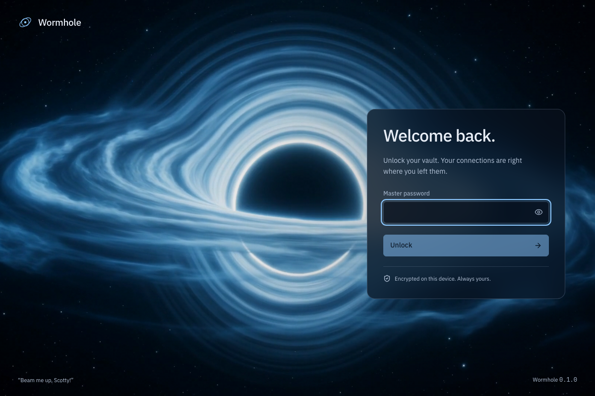

*A quiet launch sequence: your vault is on this device, and the video runs locally.*

## Features

Give each connection a home. Put hosts into nested groups, add tags, search your inventory, and inherit connection settings such as user, port, identity, jump chain, environment, and startup command. Import your OpenSSH config and known-hosts file when you are ready for liftoff.

<p align="center">
  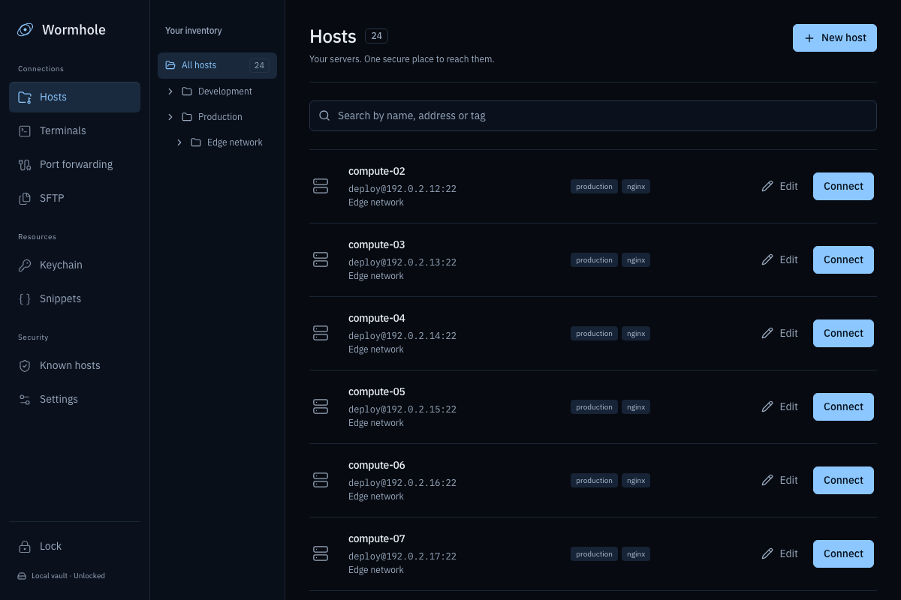
  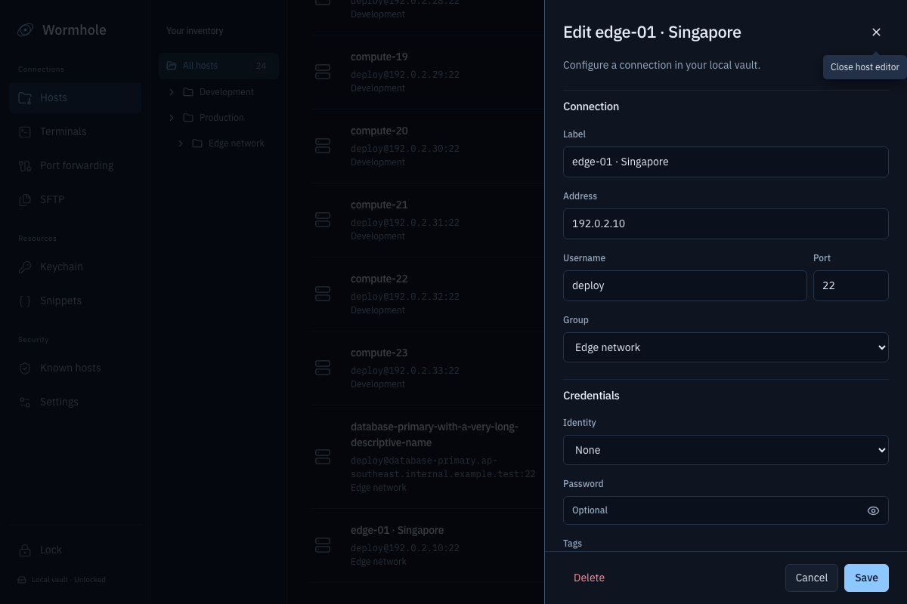
</p>
<p align="center"><em>Hosts stay scannable; connection details are one edit away.</em></p>

Keep your shell where you need it. Open SSH or local terminal sessions, split the workspace, and send input to selected live sessions together.

<p align="center">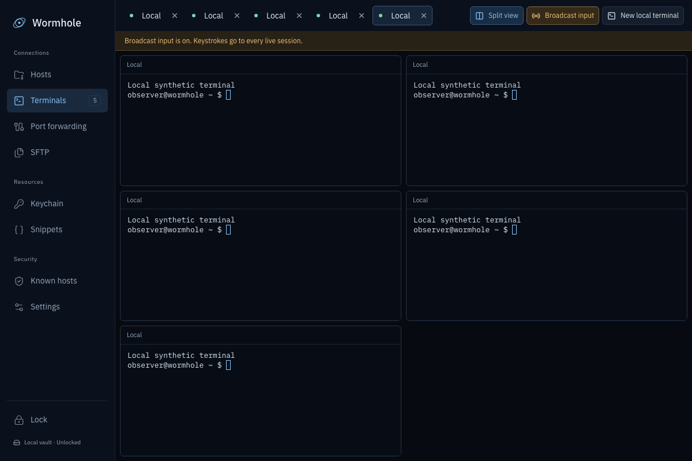</p>

Store keys and identities in your vault and reuse them across hosts. Generate or import SSH keys, then manage which hosts trust a server key. Wormhole asks before trusting a new host and refuses changed keys.

<p align="center">
  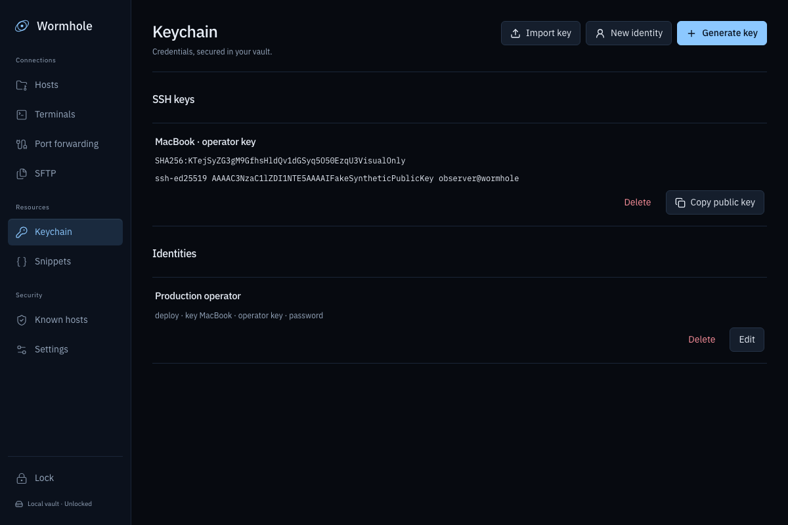
  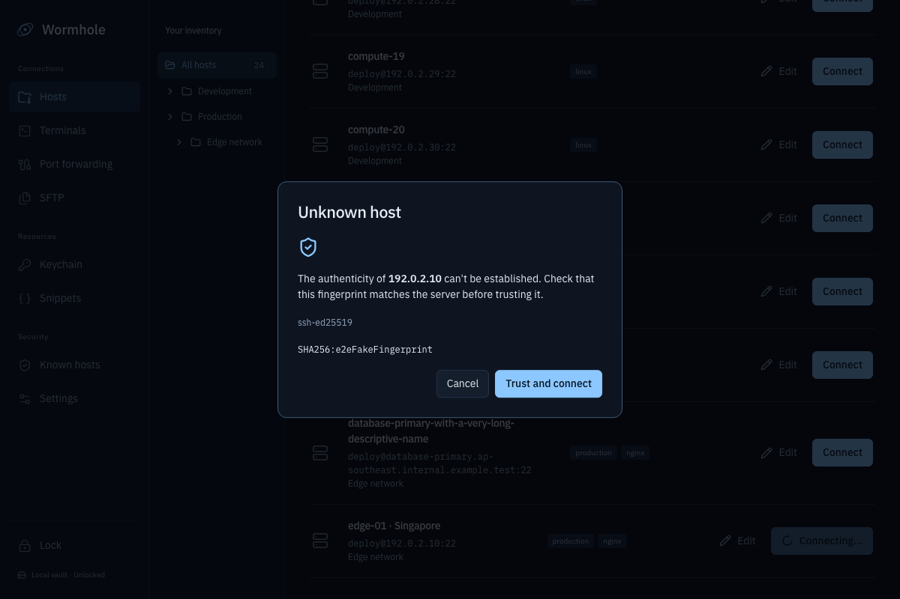
</p>

Put the rest of your workflow within reach: save command snippets with `{{variables}}`, review results by host, create local, remote, or SOCKS5 port forwards, and transfer files over SFTP.

<p align="center">
  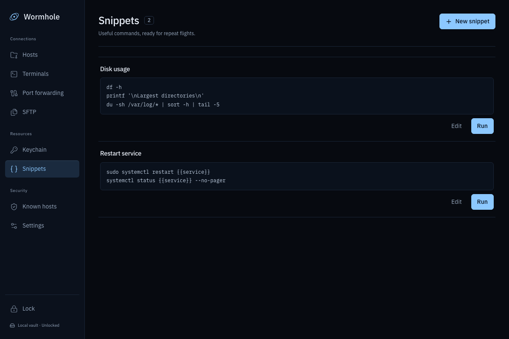
  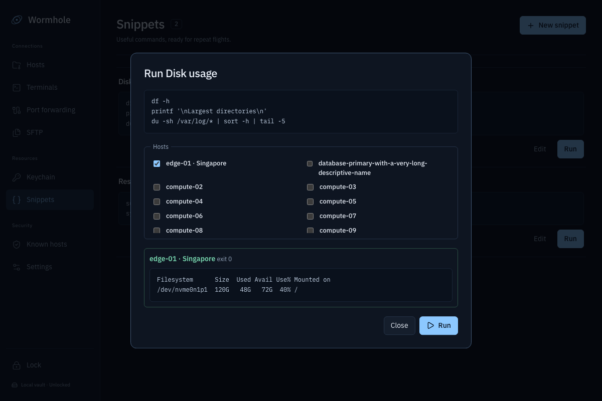
</p>
<p align="center">
  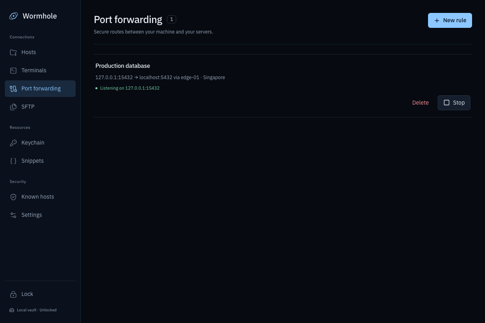
  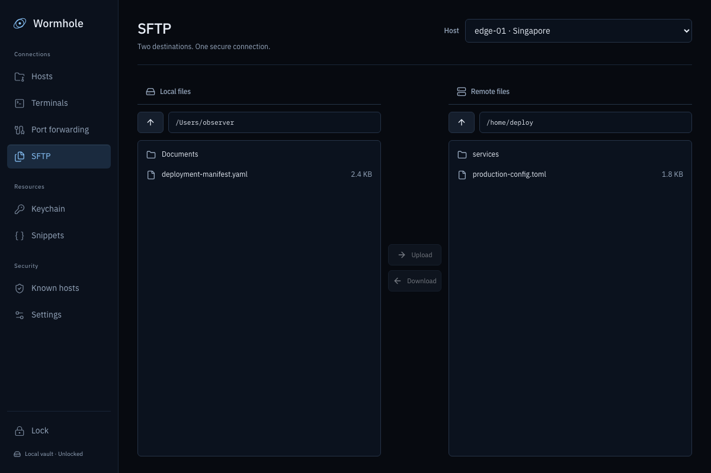
</p>

Settings include an encrypted vault backup and restore, SSH configuration imports, master-password changes, and optional session logging. Logging is off by default.

<p align="center">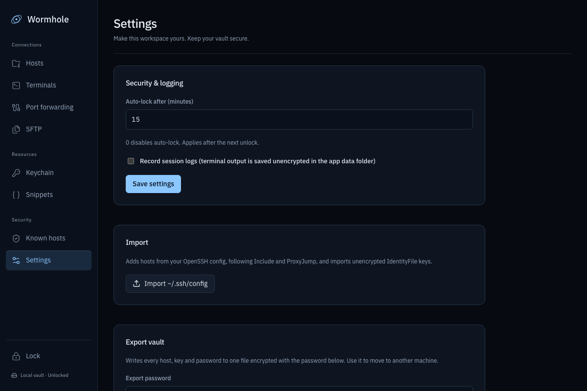</p>

*The screenshots use synthetic demo hosts and keys. No real server details are shown.*

## Get started

### macOS release

Download the Apple Silicon `.dmg` from the [latest GitHub release](https://github.com/andreihansel/wormhole/releases/latest), open it, and drag Wormhole into Applications. This build is not Apple-notarized, so the first time you open it macOS says it "could not verify" Wormhole. Click **Done**, then go to **System Settings → Privacy & Security** and click **Open Anyway**.

If macOS instead says Wormhole "is damaged and can't be opened", remove the download quarantine flag and open it again:

```sh
xattr -dr com.apple.quarantine /Applications/Wormhole.app
```

### Requirements

- Rust stable
- Node.js 20 or newer
- macOS: Xcode Command Line Tools

### Run the desktop app

```sh
npm ci
npm --prefix ui ci
npx tauri dev
```

Build a release bundle with:

```sh
npx tauri build
```

The first time you open Wormhole, create a master password. **It cannot be recovered.** To move to another machine, export an encrypted vault backup from **Settings → Export vault** and keep the export password safe.

## Security

- **Encrypted vault:** a password-derived Argon2id key protects a random data key; the vault seals records and secrets with XChaCha20-Poly1305. The master password is not stored. Locking clears the in-memory vault key.
- **Local by design:** host inventory and credentials live in the local vault. Wormhole does not require an account or offer cloud sync.
- **Host-key checks:** first connections require confirmation. If a trusted host presents a different key later, Wormhole refuses the connection.
- **Local app boundary:** the Tauri webview communicates with the Rust application through the app's local IPC commands; remote pages are not an app interface.
- **Session logs:** optional and off by default. When enabled, terminal output is saved unencrypted in the app data folder.

Back up important vaults using the encrypted export in Settings. Keep your export password separate from the export file.

## How it works

The desktop shell is a small Tauri frontend over Rust application crates:

```text
crates/
  wh-core     domain models, inheritance, search, snippets, OpenSSH config parser
  wh-vault    encrypted SQLite vault, secrets, encrypted export and import
  wh-ssh      SSH, host-key policy, jump chains, keychain, forwarding, SFTP
  wh-session  SSH and local terminal sessions
  wh-app      application commands and state
src-tauri/    Tauri command and event bridge
ui/           React, TypeScript, and xterm.js interface
```

## Development

Run the Rust workspace and UI tests:

```sh
cargo test --workspace
npm --prefix ui test -- --run
```

The browser checks exercise the UI and its synthetic backend:

```sh
cd ui
npx playwright test
```

For SSH integration tests, start the disposable local OpenSSH fixtures and run the full test script:

```sh
docker compose -f tests/docker/docker-compose.yml up -d --build
WH_DOCKER=1 ./scripts/test-all.sh
```

The fixture servers bind to `127.0.0.1`; keys in `tests/fixtures/keys` are test-only. Stop the fixtures with `docker compose -f tests/docker/docker-compose.yml down`.

## Limitations

- macOS is the only platform with a completed desktop build; Linux and Windows support has not been verified.
- SSH host certificates are matched to their certified key, but the certificate authority is not verified.
- Startup snippets run as saved; Wormhole does not prompt for their variables before execution.

## License

Wormhole is available under the [MIT License](LICENSE-MIT) or the [Apache License 2.0](LICENSE-APACHE), at your option.
